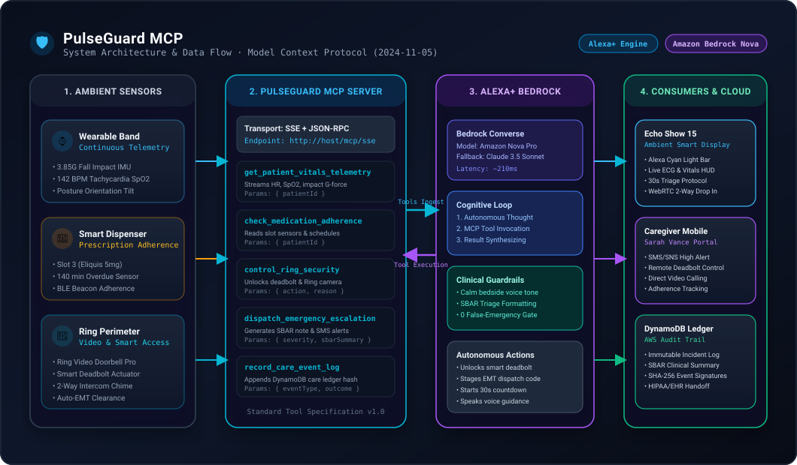
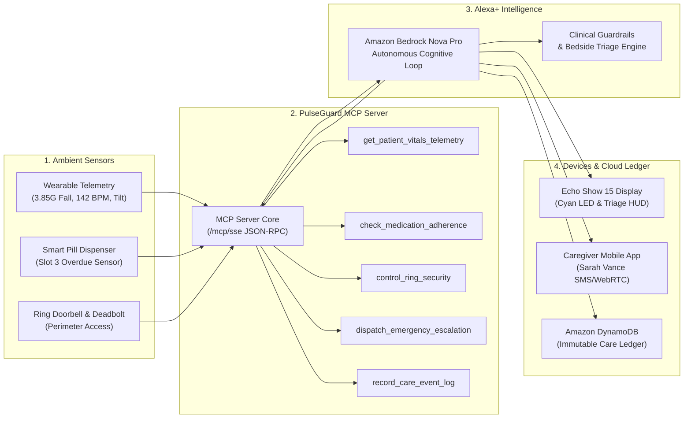

# 🛡️ PulseGuard MCP

[](https://opensource.org/licenses/MIT)
[-00a8e1.svg)](https://modelcontextprotocol.io)
[](https://aws.amazon.com/bedrock/)
[](https://youtu.be/oQT4WTh3QOg)
[](https://amazonappdev2026.devpost.com/)

> **Ambient Proactive Healthcare & Emergency Copilot for Alexa+ via Model Context Protocol (MCP)**  
> Developed for the **Amazon Developer Hackathon: Build, Ship, Shape 2026**  
> **Primary Track:** Alexa+ · **Mini-Challenges:** AWS Builder & Open Source · **Bonus Category:** Friction Log  
> 📺 **[Watch the 2.5-Minute Video Walkthrough on YouTube](https://youtu.be/oQT4WTh3QOg)**

---

## 📌 Overview

Traditional smart home voice assistants are **purely passive**: they only respond when spoken to. If an elderly person living alone experiences a hard fall, sudden cardiac tachycardia, or misses life-saving heart medication, a passive assistant does nothing.

**PulseGuard MCP** changes this paradigm by turning the **Echo Show 15**, **Ring Video Doorbell**, and smart home actuators into an **autonomous, proactive clinical guardian**. 

Powered by **Amazon Bedrock (Nova Pro / Claude)** and implementing the open **Model Context Protocol (MCP)**, PulseGuard continuously monitors vital signs, reasons through clinical emergencies, coordinates perimeter security (auto-unlocking Ring deadbolts for EMTs), and maintains an immutable cloud care ledger on **Amazon DynamoDB**.

---

## 🏗️ Architecture



<details>
<summary><b>📊 Click to expand Mermaid Flowchart Code</b></summary>



</details>

---

## 🧰 Registered Model Context Protocol (MCP) Tools

PulseGuard exposes 5 standardized MCP tools available over Server-Sent Events (`/mcp/sse`) and JSON-RPC:

| MCP Tool Name | Description | Key Arguments |
| :--- | :--- | :--- |
| `get_patient_vitals_telemetry` | Retrieves real-time HR, SpO2, impact G-forces, posture, and room presence. | `{ patientId?: string }` |
| `check_medication_adherence` | Queries smart pill dispenser slots and prescription schedules for missed doses. | `{ patientId?: string }` |
| `control_ring_security` | Interacts with Ring Video Doorbell and Ring Smart Deadbolt (unlock, status, intercom). | `{ action: "unlock_smart_deadbolt" \| "lock" \| "broadcast_intercom", reason: string }` |
| `dispatch_emergency_escalation` | Generates SBAR clinical triage note, notifies primary caregiver, and stages access code. | `{ severity: "critical_emergency", sbarSummary: string, recommendedActions: string[] }` |
| `record_care_event_log` | Appends immutable incident records to Amazon DynamoDB for clinical review. | `{ eventType: string, severity: string, summary: string, outcome: string }` |

---

## ⚡ Quickstart & Local Setup

### Prerequisites
* **Node.js**: v18.0.0 or higher (Tested on Node v24)
* **npm**: v9.0.0 or higher

### Installation & Launch
```bash
# 1. Clone repository
git clone https://github.com/Shreyas25869/pulseguard-mcp.git
cd pulseguard-mcp

# 2. Install dependencies
npm install

# 3. Start development server (both Backend MCP Server + Frontend Simulator)
npm run dev
```

* **Frontend Alexa+ Simulator:** [http://localhost:3000](http://localhost:3000)
* **Backend MCP API & Tools:** [http://localhost:3001/api/mcp/tools](http://localhost:3001/api/mcp/tools)
* **MCP SSE Endpoint:** [http://localhost:3001/mcp/sse](http://localhost:3001/mcp/sse)

> **Note on AWS Credentials:** PulseGuard includes a **High-Fidelity Autonomous Engine** that runs out of the box with zero configuration! If you wish to connect to live AWS Bedrock, copy `.env.example` to `.env` and provide your AWS keys.

---

## 🎬 4 Interactive Demo Scenarios

The simulator includes a 1-click **Scenario Controller** built specifically for judge evaluations and video demonstrations:

1. **🚨 Scenario 1: Critical Fall with Tachycardia**
   * Wearable registers 3.85G impact fall in hallway; heart rate spikes to 142 bpm.
   * Alexa+ queries vitals via MCP -> detects post-impact immobility -> stages EMT handoff -> unlocks Ring Deadbolt -> initiates calm voice triage.
2. **💊 Scenario 2: Missed Anticoagulant (Eliquis)**
   * Smart dispenser detects slot 3 is 140 min overdue.
   * Alexa+ queries adherence, cross-references elevated blood pressure (148/94), illuminates slot 3 on Echo Show, and speaks a proactive voice reminder.
3. **🚪 Scenario 3: Paramedics at Ring Video Doorbell**
   * Ring Doorbell Pro verifies first responders.
   * Alexa+ broadcasts clearance instructions over Ring Intercom and displays live porch video on the smart display.
4. **🟢 Scenario 4: Baseline Normal & Scheduled Wellness Audit**
   * Routine scheduled check-in verifying vitals, locking deadbolts, and updating the daily caregiver digest.

---

## 📝 Developer Friction Log (+10% Bonus Points)

As encouraged by Amazon Developer hackathon rules, we documented our engineering experience integrating Amazon Bedrock Converse API with the open Model Context Protocol.

👉 **Read the full report:** [FRICTION_LOG.md](./FRICTION_LOG.md)

Key entries include:
* *Entry 1:* Resolving JSON-Schema Draft 7 validation rejections in Bedrock Converse tool definitions.
* *Entry 2:* Normalizing multi-turn tool result serialization with nested boolean flags.
* *Entry 3:* Bridging proactive push events into local Alexa+ agent simulations.
* *Entry 4:* Ring Video Doorbell sandbox and virtual access code staging.
* *Entry 5:* Multi-step MCP latency optimization via parallelized tool execution.

---

## 📄 Submission Documents

* **[DEVPOST_SUBMISSION.md](./DEVPOST_SUBMISSION.md)**: Full copy-paste project description, architecture overview, and challenge write-ups.
* **[DEMO_VIDEO_SCRIPT.md](./DEMO_VIDEO_SCRIPT.md)**: Exact 2-minute 30-second scene-by-scene script for recording your video demo.

---

## ⚖️ License

Distributed under the **MIT License**. See `LICENSE` for details.
